# Airline Passenger Satisfaction Prediction

## Project Overview

The **Airline Passenger Satisfaction Prediction** project uses data analysis
and machine learning to explore passenger satisfaction and predict whether
airline passengers are satisfied or neutral/dissatisfied.

The project includes data preprocessing, exploratory data analysis (EDA),
feature engineering, data visualization, and multiple classification models
whose performance is compared.

## Objectives

1. Analyze the overall distribution of passenger satisfaction.
2. Investigate satisfaction across travel classes.
3. Compare satisfaction across types of travel and customer types.
4. Analyze the relationship between service ratings and satisfaction.
5. Study the impact of departure and arrival delays on satisfaction.
6. Build and compare machine learning classification models.
7. Identify the best-performing model using evaluation metrics.

## Technologies Used

- Python
- Pandas
- Matplotlib
- Seaborn
- Scikit-learn

## Dataset

**Dataset:** Airline Passenger Satisfaction

The dataset contains passenger information, travel details, service ratings,
flight delays, and satisfaction labels.

Important features include:

- Gender
- Customer Type
- Age
- Type of Travel
- Class
- Flight Distance
- Inflight wifi service
- Seat comfort
- Inflight entertainment
- On-board service
- Departure Delay in Minutes
- Arrival Delay in Minutes
- Satisfaction

The target variable is `satisfaction`.

The dataset is included in this repository. The script loads
`Airline Passenger Satisfaction.csv` from the same directory as the Python
file.

## Project Workflow

### 1. Data Loading and Inspection

- Load the CSV dataset using Pandas.
- Display the first five rows.
- Inspect the dataset structure and data types.
- Generate descriptive statistics.

### 2. Data Preprocessing

- Remove unnecessary columns such as `Unnamed: 0` and `id` when present.
- Check and handle missing values.
- Fill missing numerical values using the mean.
- Fill missing categorical values using the mode.
- Check for and remove duplicate records.
- Trim whitespace from categorical text values.

### 3. Exploratory Data Analysis (EDA)

Visualizations are used to identify patterns and understand passenger
satisfaction. The analysis includes:

- Distribution of passenger satisfaction.
- Age distribution of passengers.
- Satisfaction across travel classes.
- Satisfaction by type of travel and customer type.
- Service rating comparisons by satisfaction.
- A correlation heatmap of selected service ratings and flight delays.
- Arrival delay distribution by satisfaction.

### Visualization Outputs

The following charts show example outputs from the project. The box plot
compares the categorical `satisfaction` column with the numeric
`Arrival Delay in Minutes` column.

#### Exploratory Data Analysis

**Passenger satisfaction distribution**

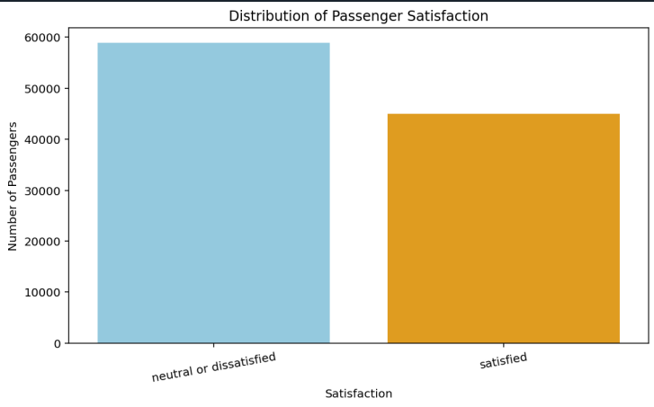

**Passenger age distribution**

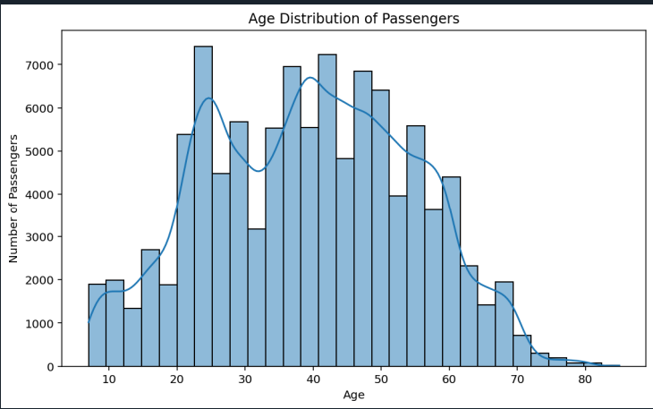

**Satisfaction by travel class**

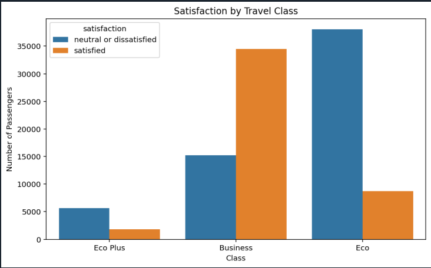

**Satisfaction by type of travel**

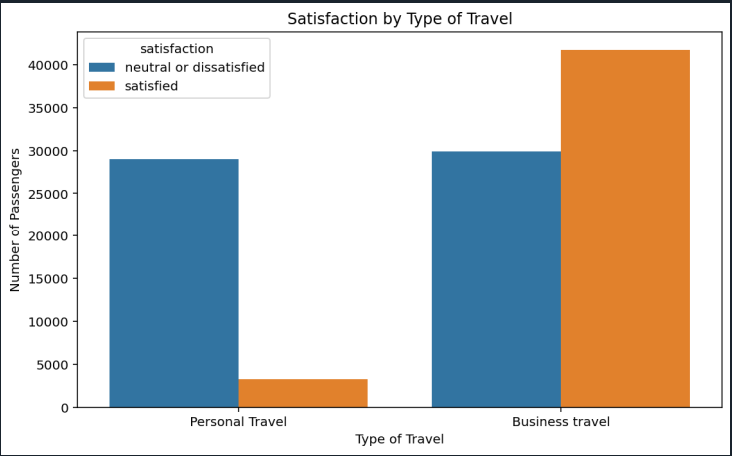

**Satisfaction by customer type**

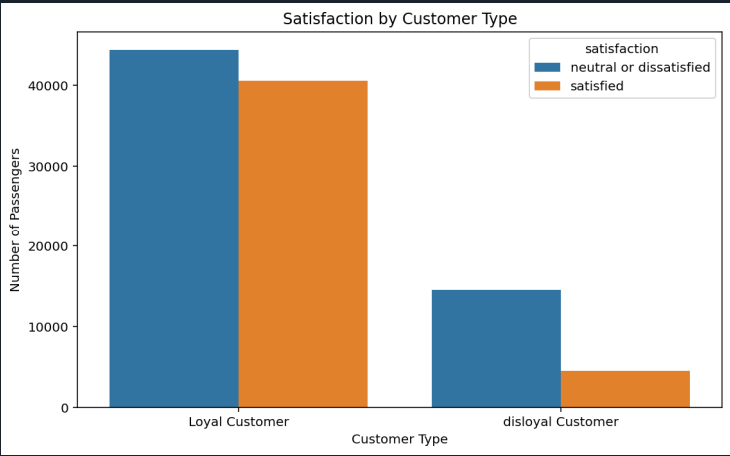

**Average service ratings by satisfaction**

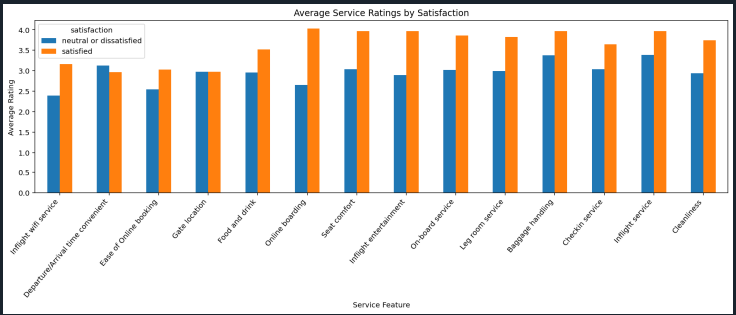

**Correlation between service ratings and flight delays**

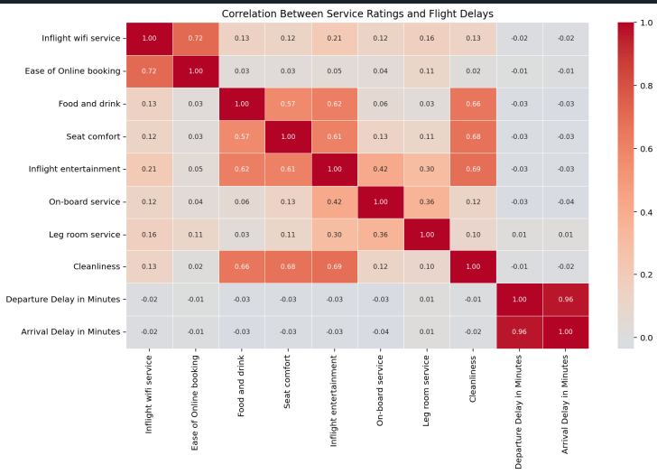

**Arrival delay by satisfaction (box plot)**

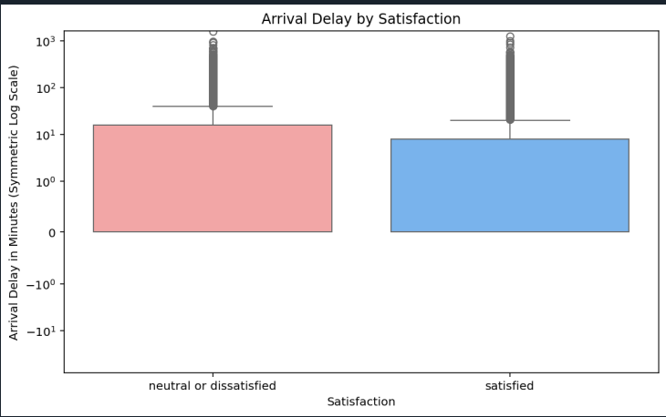

#### Model Results

**Logistic regression confusion matrix**

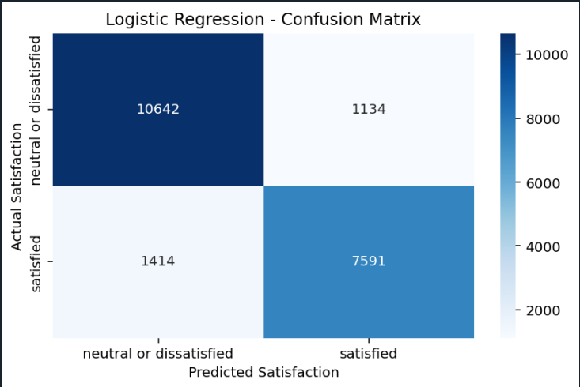

**Decision tree classifier**

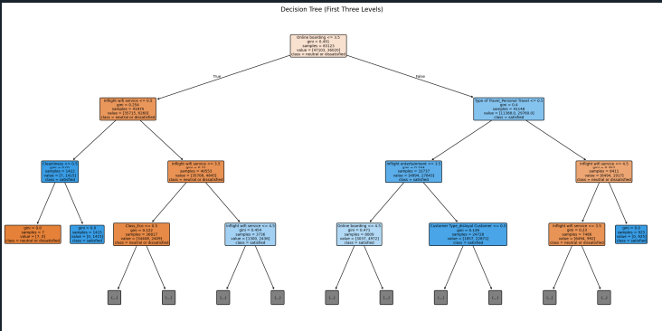

**Classification model accuracy comparison**

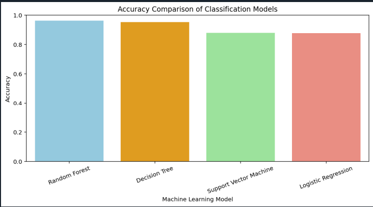

The script also prints correlation, covariance, skewness, kurtosis, and
outlier summaries for numerical data.

### 4. Feature Engineering

- Create age groups to compare satisfaction across age categories.
- Prepare features and target labels for machine learning.
- Encode categorical input features using one-hot encoding.
- Encode target labels into numeric values.

### 5. Machine Learning Models

The following classification algorithms are implemented and compared:

1. **Logistic Regression**
2. **Decision Tree Classifier**
3. **Random Forest Classifier**
4. **Support Vector Machine (SVM)**

The dataset is divided into stratified training and testing sets. The SVM is
trained on at most 15,000 rows from the training set to keep its runtime
practical.

### 6. Model Evaluation

The models are evaluated using:

- Accuracy
- Weighted precision
- Weighted recall
- Weighted F1-score
- Confusion matrix
- Classification report

A model comparison chart compares accuracy. The best model is selected by
weighted F1-score, and its accuracy is also reported.

## Installation and Execution

### Prerequisites

Install Python 3, then install the required libraries from the project folder:

```powershell
python -m pip install -r requirements.txt
```

### Run the Project

1. Clone or download this repository.
2. Open the project folder in VS Code, Spyder, or a terminal.
3. Run the Python file:

```powershell
python "Predictive Project.py"
```

## Expected Outcomes

The project aims to:

- Understand factors associated with passenger satisfaction.
- Identify patterns in service ratings, travel classes, and flight delays.
- Compare four machine learning classification models.
- Determine the best-performing model based on measured evaluation metrics.
- Present findings through visualizations and classification reports.

Actual findings and model performance depend on the results obtained when
running the project.

## Future Improvements

- Tune model hyperparameters to improve predictive performance.
- Perform additional feature selection and engineering.
- Develop an interactive dashboard for exploring passenger satisfaction.
- Deploy the selected model as a prediction application.

## Conclusion

This project demonstrates an end-to-end data science workflow, from data
preprocessing and exploratory analysis to feature engineering and machine
learning model evaluation. It provides a structured approach to understanding
airline passenger satisfaction and comparing classification algorithms.

---

**Project Category:** Data Science and Machine Learning

**Language:** Python

**Task:** Binary Classification
